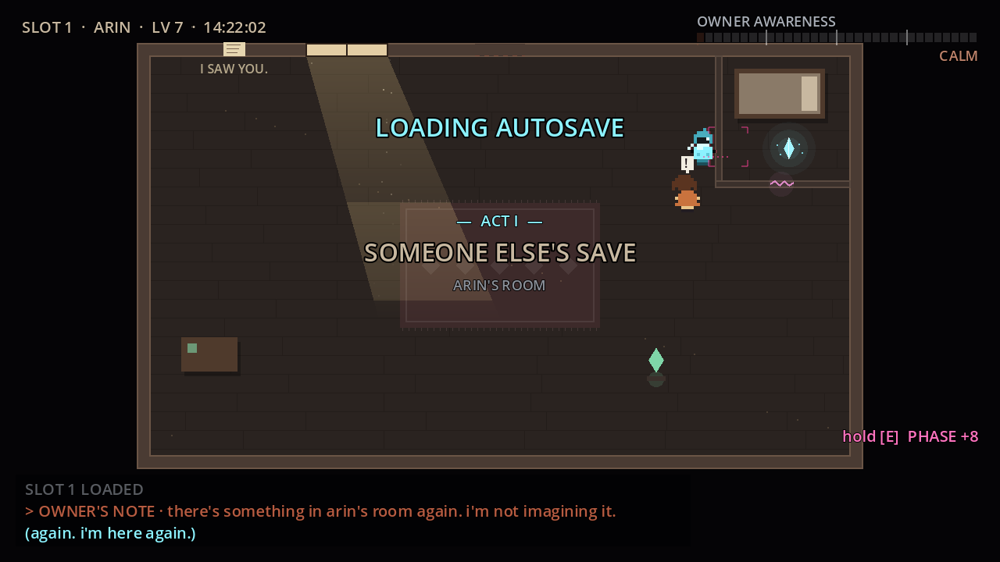
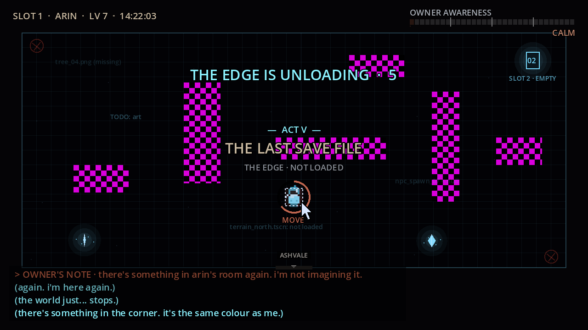

# First minutes: fairness and readable threats

Base: `game-presentation-polish` at `2c0936f`. Findings below are code and
functional-test observations, not human playtest results.

## Priority and scope

1. **High — the wrong glitch at the first partition.** At (450, 100), facing
   right, FREEZE selected Mira behind the player instead of crossing the thin
   wall. A real held-input test reproduced the wrong ability and awareness cost.
   Explicitly facing a CrackedWall now prioritises PHASE when a valid landing
   exists. Ordinary NPCs, hostile Arin, other walls and doors retain their rules.
2. **High — an obscured warning.** The tutorial overlapped the reload banner and
   consumed reading time while the warning was visible. Banners now hide tips
   immediately. Tutorials pause during banners and choices and resume afterward.
3. **Medium — advice before its context.** Wren was taught in the opening room.
   Her shelter lesson now waits until the square's Arin lesson and proximity to
   a present Wren. Actually sheltering teaches the lesson without a redundant tip.
4. **Medium — cursor readability.** Selection used a box around the cursor rather
   than Rue. A steady owner-coloured ring, filling over the existing selection
   interval, and MOVE label now identify the selected character. No enemy speed,
   grace period or selection duration changed. Screen effects are optional.
5. **Medium — first owner line and warning mix.** Boot owner lines use the
   established owner colour, synthetic owner voice and OWNER narration role;
   following system lines restore their original colour. The adaptive melody
   ducks under owner banners. Optional system speech suppresses typing sounds
   in these scenes; this is not recorded voice acting.

## Distribution

The existing build workflow now also runs on this exact playtest branch. It
checks official Godot download SHA-512 sums before extraction, tests the game,
exports the builds and uploads GitHub Actions artifacts. Windows includes launch
instructions and the game licence. The separate PR job uses GitHub's scoped
workflow token to request review after the build; repository settings may forbid
Actions from creating pull requests. It never merges a PR or deploys Pages from
this branch. The cloud machine's GitHub API currently returns Forbidden, so an
Actions-created PR must be verified separately rather than assumed successful.

## Visual review

Staged software-GL screenshots, with screen effects off and reduced flashing,
show presentation rather than human playtest findings. The cursor shot holds
selection at 65% to inspect the ring without killing the staged character.

## Validation

- Before fixes: the three initial reproductions failed (wrong ability at the
  partition, warning/tip overlap and premature Wren lesson).
- Six targeted regressions pass, including actual held input across the wall,
  suspended/resumed lessons, warning mix and owner caption/narration identity.
- Full Godot 4.3 suite: **251 passed, 0 failed**, exit 0, in **804.1 seconds**.
- Message-ending bot at the supported 3x speed: **1 passed, 0 failed**, one
  session, all five memories, Pip found, **0 deaths, 0 stalls**, in 80.7 real seconds.
- Native software-GL presentation reviewed with effects off and reduced flashing;
  also captured the cursor with Large text enabled. Screenshots above are staged.
- Windows release export succeeded. Verified x86-64 PE header, embedded game-pack
  footer and ZIP integrity (29.2 MB). The ZIP includes launch instructions and licence.
- Exported Linux game pack and launched it successfully with Godot 4.3.
- Workflow YAML, embedded checksum Python and every shell step pass syntax checks.

### Remaining limits

The Windows executable has not been run on Windows. No human first-ten-minute
playtest or physical controller/mobile test occurred. Audio rendering and routing
passed the existing tests; audible mix and system narration voice quality were
not judged. This cloud graphical runtime lacks a system speech service and emits
its existing native voice-availability diagnostic; captions and procedural voices
remain available. Some exits retain the existing ObjectDB cleanup warning.
GitHub CI and PR creation are separate from these local results and must be
checked after pushing. A PR permission failure does not turn a validated build
into a failed gameplay check; report the review status separately.
