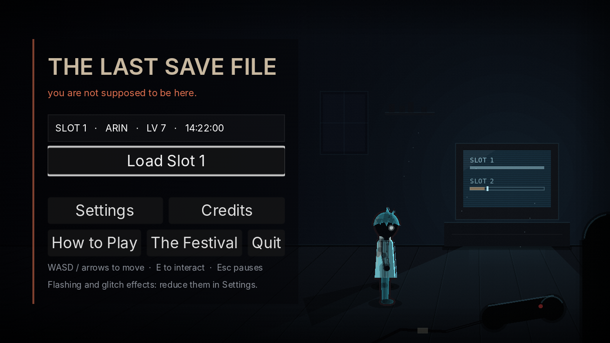
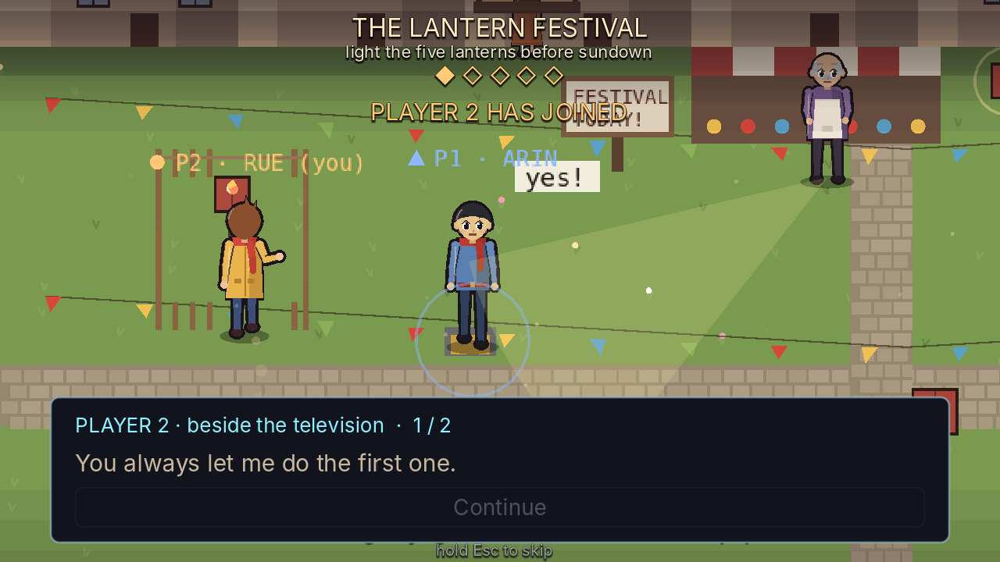

# Integrated opening and story-pacing milestone — 26 October 2026

## Scope and ancestry

The author requested merging the reviewed work into `main` and implementing
the follow-up prompt. The repository had advanced substantially since that
prompt was written. Rebuilding its completed systems would have discarded
work, so this milestone integrates them and finishes a focused pacing pass.

- Remote `main` at review: `09aeb3b`.
- Reviewed source branch: `claude/last-save-file-prototype-ljwuq4`, `095ab8c`.
- Integration commit: `791d9b1` (a real merge, preserving source ancestry).
- Additional implementation: `9f1c191`.
- Working branch: `codex/interactive-presentation-oct26`.
- The final main push is performed only after verification.

This is a completed integration/pacing milestone, not a claim that the entire
commercial production brief is finished.

## Preserve the author's actual premise

`CANON_DECISIONS.md` records the decision made on 22 October: Rue is the
**game character** left running after her player moved away. She is not a
literal trapped portion of the girl. The earlier proposed premise in the
chat prompt is superseded by that decision.

The well keeps recordings; it does not establish live contact. Arin is a
mute avatar. New Player 1/Player 2 dialogue is explicitly captioned as coming
from beside the television, not as Arin or Rue speaking.

## What was already implemented on the incoming branch

Checked against the source and the current milestone documents:

| Prompt requirement | Integrated implementation |
| --- | --- |
| Interactive beginning | `Prologue`: playable festival, co-operative lantern tasks, a remembered choice, the departure, passage of time and the Owner's return |
| Dimensional title | `TitleArt`: four depth layers, perspective floor, cast/contact shadows, screen lighting, foreground controller and restrained drift; reduced motion disables drift |
| Better map flow | Wider Square with a bounded camera, subspaces, crossing/lamp and a shortcut; arrival and environmental continuity improvements |
| Checkpoint story | Optional earlier recovery anchor under the well; Wren's remembered chalk-mark scene after returning |
| Persistent characters | Ordered relationship occurrences, consequences waiting for the next meeting, Mira/Wren/Tobben reactions |
| Readable archive | Six sections, discovered facts separated from claims, revisions and reader position retained |
| Narrative framing | Save-derived missions, the festival's later payoffs, explicit replay frames for the girl's memories |
| Revelation | CHARACTER FILE and Rue's own press distinguish her from the player who made her; no incompatible new twist added |
| Commercial preparation | Existing commercial direction, store kit, optional demo gate, voice audition script and playtest protocol |

These are inherited improvements, not newly authored art or engineering
attributed to this pass. Some incoming documents are historical. Their old
branch hashes, test totals and open proposals are not current verification.

## New implementation

### Player-paced story breaks

`PrologueStory` is a small written-story reader, separate from the festival's
movement/rendering code. It provides wrapping, scalable text and a Continue
button, with keyboard, controller-confirm and pointer input paths.

Four short moments now have explicit reading ownership:

1. First lantern: a small exchange between the two people outside the game.
2. Shared maypole: their double-tap ritual and Mira's response from the window.
3. Historical message: her complete question and the Owner's unfinished,
   unsent reply. The date/context is part of the caption.
4. Present-day recognition: the Owner's question, followed by Rue noticing
   that she can still move without her controller being held.

Manual advancement is the default. Auto mode uses `StoryPacing.reading_time`
and the player's reading-speed preference. These pages contain **no recorded
acting and no newly generated speech**.

Reading stops the festival simulation, movement assistance, decision clocks
and timed departures. Focus/controller holds also stop the reader's clock.
The triggering press cannot acknowledge the next page: release and debounce
are required. Closing a page also waits for release before movement resumes.

The fast Esc skip remains available, including during the final reading hold.
Skipping dismisses pages without pretending they were read. Replay does not
write to the player's collections. No run is armed before the existing handoff.

### A durable transcript

Acknowledged pages are saved through the existing `OwnerMemory.record_read`
path as Documents, using stable `festival:*` IDs. Pages still waiting on the
screen are not recorded. The transcript survives reload, and preserves the
outside-speaker labels so it cannot imply that Rue is the girl.

The existing journal schema supports these entries; no destructive migration
or duplicate persistence layer was introduced.

### Input and accessibility fixes

- `TouchControls.cancel_touches()` releases held virtual controls when the
  reader takes over. Its controls are suspended until gameplay resumes.
- The loading tear now independently respects Reduce flashing and zero
  glitch intensity. Previously it checked only Reduce motion.
- Large-text testing caught an initial wrapping/minimum-size overflow in the
  new reader. Explicit content width and bottom placement fixed it before
  acceptance.





## Verification

Verification targets runtime commit `9f1c191` using **Godot 4.3**. Later
verification/documentation commits do not alter the runtime. Test/export data is isolated
under writable XDG paths; no real player profile is used.

Final full-suite result: **691 passed, 0 failed**, 1489.5 seconds, exit 0;
691 unique cases across 96 test files. No script errors. The existing
ObjectDB shutdown warning remains visible in the log.

Completed checks:

- Integration baseline: 26/26 focused checks before the new pacing code.
- Ending bots: 5/5 exact requested outcomes, 244.8 seconds, zero deaths.
  The purge-3 escape route recovered three steering stalls. Bot outcomes do
  not establish human difficulty or comprehension.
- Rendered staging tour: 1/1, six saved screenshots under `review/oct26`.
  Includes large text, the historical message, present-day reveal and room
  handoff. Some frames are staged; they are not a full human playthrough.
- Windows, Linux and Web export commands: exit 0. Build hashes are recorded
  in `review/oct26/build-hashes.json`.
- Exported Linux build: 240 headless frames, exit 0.
- Windows ZIP: nonempty executable present; ZIP integrity verified. Windows
  execution itself remains untested.
- Browser lifecycle: title, festival, skip, playable room, keyboard movement,
  IndexedDB save, leave guard and quit-on-reopen all pass without page errors.
- Browser audio graph: audible after a gesture, no visible sound badge and
  no page errors. This measures output, not a human listening judgement.
- Additional exported-Web story check: after assistance reaches the first
  lantern, a real keyboard press records exactly one page, a real Continue
  click records its reply, and session/purge remain zero. No page errors.
  The observed saved entry and browser screenshots are in `review/oct26`.

Browser checks used installed system Chromium through Playwright, with
SwiftShader. The normal Playwright browser download was unavailable (HTTP
403); no dependency or product code was changed to conceal that limitation.

The initial local command used an unwritable default data directory and the
engine aborted; the baseline was rerun with writable isolated XDG directories.
An accidental editor import with the system's newer Godot was followed by
the required Godot 4.3 import. Generated untracked UID sidecars were removed;
all accepted verification and exports use 4.3.

### Reproduction

Use Godot **4.3**, its matching export templates and a writable XDG data,
config and cache directory. The strict runner imports first and rejects
script errors as well as failed assertions:

```sh
GODOT=/path/to/godot-4.3 tests/run.sh
GODOT=/path/to/godot-4.3 tests/run.sh --filter=prologue_story,first_session,touch,fonts
GODOT=/path/to/godot-4.3 tests/run.sh --bots --speed=3
/path/to/godot-4.3 --path . -s res://tests/run_tests.gd -- --test-mode --tour --filter=tour_story_revision --screenshots=/tmp/story-review
/path/to/godot-4.3 --headless --path . --export-release "Windows Desktop"
/path/to/godot-4.3 --headless --path . --export-release "Web"
/path/to/godot-4.3 --headless --path . --export-release "Linux"
```

The visual tour requires a display (or Xvfb); do not run it headless and
interpret absent pixels as visual evidence. Serve `build/web` over HTTP,
install Playwright and its browser, then use:

```sh
node tests/web/web_check.cjs http://127.0.0.1:8876/index.html
node tests/web/audio_output_check.cjs http://127.0.0.1:8876/index.html
node tests/web/prologue_story_check.cjs http://127.0.0.1:8876/index.html
```

The additional story checker accepts `CHROMIUM_EXECUTABLE_PATH` for a system
browser, an output-directory argument, and `STORY_WAIT_MS` for a slower
software-rendered machine. It is an optional exported-build regression,
not a newly imposed CI timeout.

## Remaining production work

- Hand-authored final character/environment art and acting, with licensed
  assets, consent and human review. The cast remains procedural fallback art.
- A larger redesign of the festival as a full dramatic first act. The
  incoming `OPENING_REIMAGINED_PROMPT.md` is a separate, more ambitious brief;
  extra effects or these short conversations do not fulfil it in entirety.
- Recomposition of the other maps; the wider Square is not seven enlarged
  maps.
- Save and Exit / Continue. The recovery anchor still applies to death;
  existing warned quit/crash consequences have not silently changed.
- Uncoached player sessions, human listening, Windows/controller/iPhone
  execution, and real GPU/frame-time measurements.
- Existing shutdown/resource warnings, reported rather than suppressed.
- Market validation and production budgeting. No revenue, conversion,
  wishlist or playtest results are invented; no assets or voice credits were
  purchased and no commercial store page was published.

Use the main branch's successful GitHub Actions run to download the Windows
artifact. A workspace path is not a public download link. CI will rebuild and
package the pushed revision; local export success is not a completed CI run.
