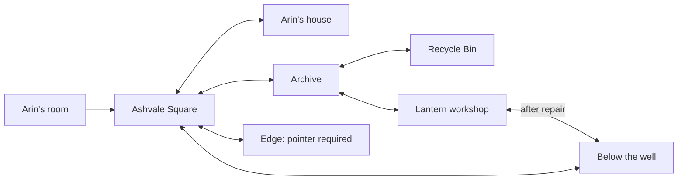

# Unified gameplay and world pass — 30 October 2026

## Scope and baseline

Base: main `a81baf7`, including PR #12. Previous input work `b5b0c36`
is integrated, with its original history joined by merge `0ef1dbb`.
New gameplay runtime: `a47e3f5`; final runtime `2f03453` also keeps the
portrait instruction above menus and specifies service-hatch/front-door facing. Later commits alter tests/history/docs,
not runtime. All remote branches available at review time were already
ancestors of main; no historical alternative premise was reapplied.

This is a bounded implementation milestone, not a commercial 1.0 claim.

## Player-facing changes

- Normal doorways have quieter audio, shorter fades (0.12 / 0.16 seconds,
  previously 0.25 / 0.30), and no automatic picture-tearing event. The Edge
  retains its rupture; Out of Bounds retains a smaller passage effect.
- Stone/brass threshold strips and arrows mark ordinary crossings. Arrival
  facing follows the entrance. Transition time holds threats and clears held
  virtual input; keyboard travel need not be re-pressed at every door.
- Portrait touch play opens a real pause. Landscape removes the notice but
  does not automatically resume. Resume is refused behind the portrait notice;
  existing pause/focus/controller reasons are not cleared by rotating.
- The cold open respects text speed/Instant, reveal then advance, and focus
  loss. Virtual controls handle focus loss and OS-cancelled touches.
- HeroFigure foot stance follows actual ground direction, including front,
  back and diagonals. The new analytical regression covers eight directions
  at scale 1 and 1.35. This is not a claim that every turning/crouching rendered
  animation or every imported artist sheet has been certified.

## The workshop mission

A new service room beneath the Archive uses its stone, timber, brass and warm
light palette. A clear stair, workbenches, spare lantern frames, wick and hatch
have distinct silhouettes. No external assets or actor performances were bought.

| Stage | Player action | Persistent result |
| --- | --- | --- |
| Discover | Walk down the Archive's south stair | Workshop in Places/map; local mission and optional lead |
| Collect | Take the spare festival wick on the west bench | One carried artefact in Objects; recoverable description |
| Repair | Fit it to the centre service lantern | Light, ground route line, completed mission, wick marked used |
| Use | Take the lit hatch to the well landing | Two-way shortcut; rebuilt rooms preserve repair |
| Recognise | Speak to Wren after meeting her and repairing the lamp | She notices light between the stones and asks to leave it on; acknowledgement persists |
| Stop | Use existing Save and Exit in the calm workshop | Workshop is a valid suspend destination; existing atomic saving retained |

The repair is optional. It does not replace the main objective outside the
workshop, grant an ending, remove the original well climb, or bypass the far
ledge's floor puzzle. Mission/object state uses existing saved events; old saves
need no required new fields. A normal old save begins with this side task undone.

Before: well landing → Square → exposed crossing → Archive.
After earning the route: well landing → workshop → Archive.
The ordinary Square route remains available. No reduction in whole-campaign
backtracking or total playtime is claimed without human route measurements.

## Connected route

## Defects caught during implementation

- A first workshop layout placed a bench across the stair approach. The rendered
  walking route found it; moved clear and added a native movement regression.
- The arrival-facing heuristic chose left for the new stair. Replaced the
  centre-vector heuristic with explicit entrance directions.
- The house unlock test dereferenced the old Square after a faster crossing
  had already arrived in the house. It now accepts the successful arrival
  and still checks that UNLOCK is offered and the house is reached.
- The audio test expected the old rupture cue on every room change. Updated to
  require the new quiet normal-door cue and reject the impossible-passage cue.
- The tour initially checked an interaction before the existing tap/hold
  arbitration resolved it. The check now waits on the resulting state.
- Historical review JPEGs caused image-import errors. `docs/.gdignore` keeps
  documentation evidence out of Godot's resource importer and game resources;
  originals remain in Git. Runtime has no dependency on `res://docs/`.

## Verification

Final results and evidence are recorded in VERIFICATION.md alongside this file.
The new resume tour closes and relaunches at all three workshop stages (empty,
wick carried, repaired), checking position, hatch, inventory, quits and purge.
An aborted early full run is not counted as a passing suite. Rendered screenshots
use software Mesa llvmpipe, not a hardware GPU benchmark. Browser checks use the
exported Web game in Chromium; they do not certify iPhone Safari.

## Remaining production work

- Unfamiliar players and the owner's friends must retest this revision on their
  actual devices, noting build/input/browser and where navigation breaks down.
- Final commissioned/approved character and environment art, voice production,
  and a representative finished Square remain beyond this procedural-art pass.
- Physical Windows gameplay, controller feel/remapping, iPhone interruptions,
  browser storage eviction and human listening need actual platform sessions.
- Full campaign density, pacing, repeated travel and price/value are unmeasured.
- Existing ObjectDB shutdown warning remains; no formal flash-threshold claim.
- The festival remains part of the first-run experience and available for replay.
  This pass does not add mandatory flashbacks or rewrite approved canon.

## Repeatable verification speed

The suite now supports `--shard=i/n` (1-based, at most 8), distributing the
stable filtered test order between processes. Each process must use separate
XDG data/config/cache directories. Default execution still runs the entire
suite in one process, and CI's existing command is unchanged. `--list-tests`
prints the selected cases without executing them. Invalid shard input exits 2.

This round's final full coverage is a **four-shard run at normal game speed**,
not a completed monolithic run. Compare all PASS identifiers against the
unsharded `--list-tests` inventory: every expected case must occur exactly
once, with zero FAIL/SCRIPT ERROR and four successful completed summaries.
Do not combine results from aborted earlier runs into this total.

## Integration boundaries

The final milestone includes prior main work and the input-fix branch, not
uncommitted diagnostic probes from historical worktrees. Existing branches
are retained for history. No force push, tag, asset purchase or voice cloning
is part of the integration. Main's existing build workflow is responsible
for producing downloadable artifacts and deploying the public Web build.
A local ZIP path is not a public download URL.

## Test limitations found, not hidden

One exported story-reader check, while other software-rendered checks were
competing for the machine, acknowledged the keyboard page but did not keep
the subsequent Continue click. The same unchanged check passed on a serial
rerun with fewer software-renderer threads. Both logs are retained. This is
not proof of a resolved low-frame-rate input issue: investigate on a slow
physical device before claiming mobile support.

The five ending-bot routes passed on the gameplay runtime before the final
portrait-layer and entrance-facing metadata corrections. Purge-3 needed two
deaths/retries (Square and Edge); Wren's route recovered two steering stalls.
The opt-in scarred-Square probe returns without running unless explicitly
enabled, so the runner's sixth PASS is not a sixth played ending route.

Sharding exposed one pre-existing test-order dependency: a festival test left
Prologue.boot_shown set, so a later fresh-profile boot check skipped the boot.
The fresh-profile fixture now resets that one-shot handoff. Runtime behaviour
is unchanged. Final coverage uses a complete new four-shard run after this
fixture correction, not passed cases borrowed from the failed attempt.
